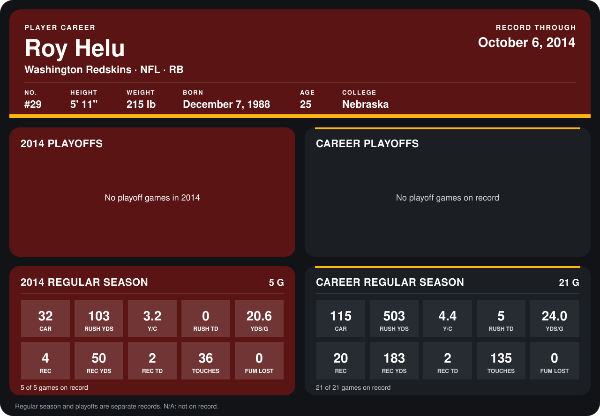

# Roy Helu

## Career stats

### Regular season

| Season | Club | G | CAR | RUSH YDS | Y/C | RUSH TD | YDS/G | REC | REC YDS | REC TD | TOUCHES | FUM LOST |
|---|---|---:|---:|---:|---:|---:|---:|---:|---:|---:|---:|---:|
| 2013 | Washington Redskins | 16 | 83 | 400 | 4.8 | 5 | 25.0 | 16 | 133 | 0 | 99 | 0 |
| 2014 | Washington Redskins | 5 | 32 | 103 | 3.2 | 0 | 20.6 | 4 | 50 | 2 | 36 | 0 |
| **Career** |  | 21 | 115 | 503 | 4.4 | 5 | 24.0 | 20 | 183 | 2 | 135 | 0 |

### Playoffs

No playoff games on record.

## Awards

None on record.

Records through October 6, 2014. Identity: listed 2014 roster data, Weeks 1-4; number: 2014 Week 1 roster. [All Washington Redskins players](README.md).
