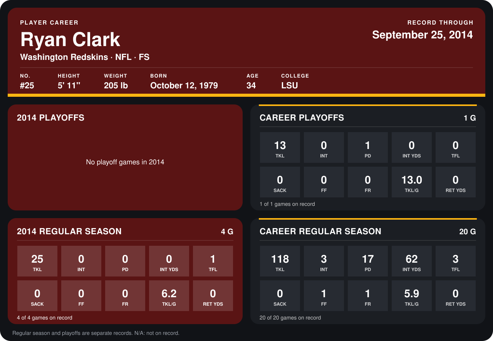

# Ryan Clark

## Career stats

### Regular season

| Season | Club | G | TKL | INT | PD | INT YDS | TFL | SACK | FF | FR | TKL/G | RET YDS |
|---|---|---:|---:|---:|---:|---:|---:|---:|---:|---:|---:|---:|
| 2013 | Pittsburgh Steelers | 16 | 93 | 3 | 17 | 62 | 2 | 0 | 1 | 1 | 5.8 | 0 |
| 2014 | Washington Redskins | 4 | 25 | 0 | 0 | 0 | 1 | 0 | 0 | 0 | 6.2 | 0 |
| **Career** |  | 20 | 118 | 3 | 17 | 62 | 3 | 0 | 1 | 1 | 5.9 | 0 |

### Playoffs

| Season | Club | G | TKL | INT | PD | INT YDS | TFL | SACK | FF | FR | TKL/G | RET YDS |
|---|---|---:|---:|---:|---:|---:|---:|---:|---:|---:|---:|---:|
| 2013 | Pittsburgh Steelers | 1 | 13 | 0 | 1 | 0 | 0 | 0 | 0 | 0 | 13.0 | 0 |
| **Career** |  | 1 | 13 | 0 | 1 | 0 | 0 | 0 | 0 | 0 | 13.0 | 0 |

## Awards

None on record.

Records through September 29, 2014. Identity: listed 2014 roster data, Weeks 1-4; number: 2014 Week 1 roster. [All Washington Redskins players](README.md).
