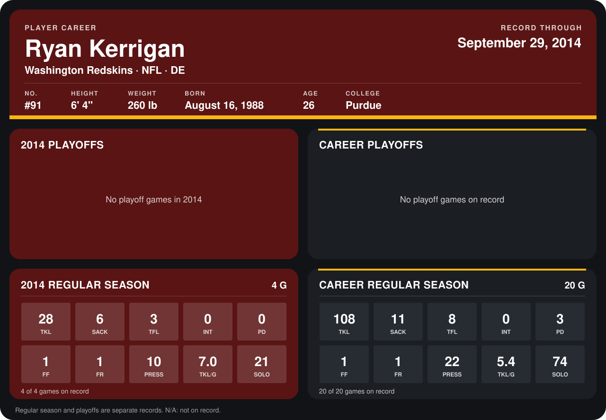

# Ryan Kerrigan

## Career stats

### Regular season

| Season | Team | Age | # | G | TKL | SACK | TFL | INT | PD | FF | FR | PRESS | TKL/G | SOLO |
|---|---|---:|---:|---:|---:|---:|---:|---:|---:|---:|---:|---:|---:|---:|
| 2013 | Washington Redskins | 25 | 91 | 16 | 80 | 5 | 5 | 0 | 3 | 0 | 0 | 12 | 5.0 | 53 |
| 2014 | Washington Redskins | 26 | 91 | 4 | 28 | 6 | 3 | 0 | 0 | 1 | 1 | 10 | 7.0 | 21 |
| **Career** |  |  |  | 20 | 108 | 11 | 8 | 0 | 3 | 1 | 1 | 22 | 5.4 | 74 |

### Playoffs

No playoff games on record.

## Awards

- NFC Defensive Player of the Week (2014, Week 4)

Age is his age on the league's opening game of each season; # is the number listed for him that season with that team (2014: the card's rule; 2013: the 2013 season roster), N/A where no listing applies.

Records through September 25, 2014. Identity: listed 2014 roster data, Weeks 1-4; number: 2014 Week 1 roster. [All Washington Redskins players](README.md).
