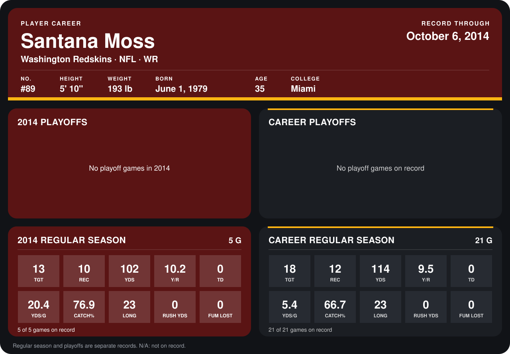

# Santana Moss

## Career stats

### Regular season

| Season | Club | G | TGT | REC | YDS | Y/R | TD | YDS/G | CATCH% | LONG | RUSH YDS | FUM LOST |
|---|---|---:|---:|---:|---:|---:|---:|---:|---:|---:|---:|---:|
| 2013 | Washington Redskins | 16 | 5 | 2 | 12 | 6.0 | 0 | 0.8 | 40.0 | 7 | 0 | 0 |
| 2014 | Washington Redskins | 4 | 10 | 8 | 67 | 8.4 | 0 | 16.8 | 80.0 | 12 | 0 | 0 |
| **Career** |  | 20 | 15 | 10 | 79 | 7.9 | 0 | 4.0 | 66.7 | 12 | 0 | 0 |

### Playoffs

No playoff games on record.

## Awards

None on record.

Records through September 29, 2014. Identity: listed 2014 roster data, Weeks 1-4; number: 2014 Week 1 roster. [All Washington Redskins players](README.md).
