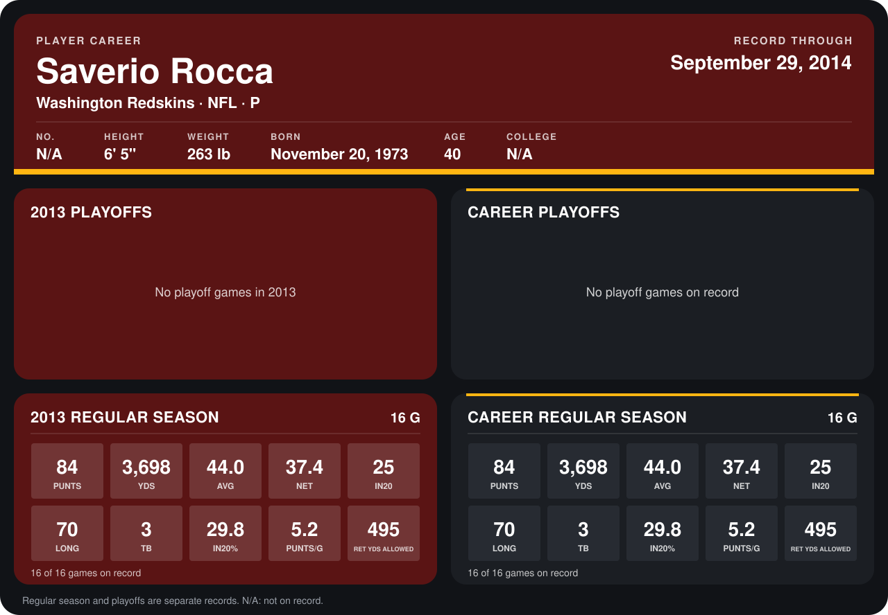

# Saverio Rocca

## Career stats

### Regular season

| Season | Club | G | PUNTS | YDS | AVG | NET | IN20 | LONG | TB | IN20% | PUNTS/G | RET YDS ALLOWED |
|---|---|---:|---:|---:|---:|---:|---:|---:|---:|---:|---:|---:|
| 2013 | Washington Redskins | 16 | 84 | 3,698 | 44.0 | 37.4 | 25 | 70 | 3 | 29.8 | 5.2 | 495 |
| **Career** |  | 16 | 84 | 3,698 | 44.0 | 37.4 | 25 | 70 | 3 | 29.8 | 5.2 | 495 |

### Playoffs

No playoff games on record.

## Awards

None on record.

Records through September 29, 2014. Identity: the public player file's latest listing (no 2014 Weeks 1-4 roster row). [All Washington Redskins players](README.md).
