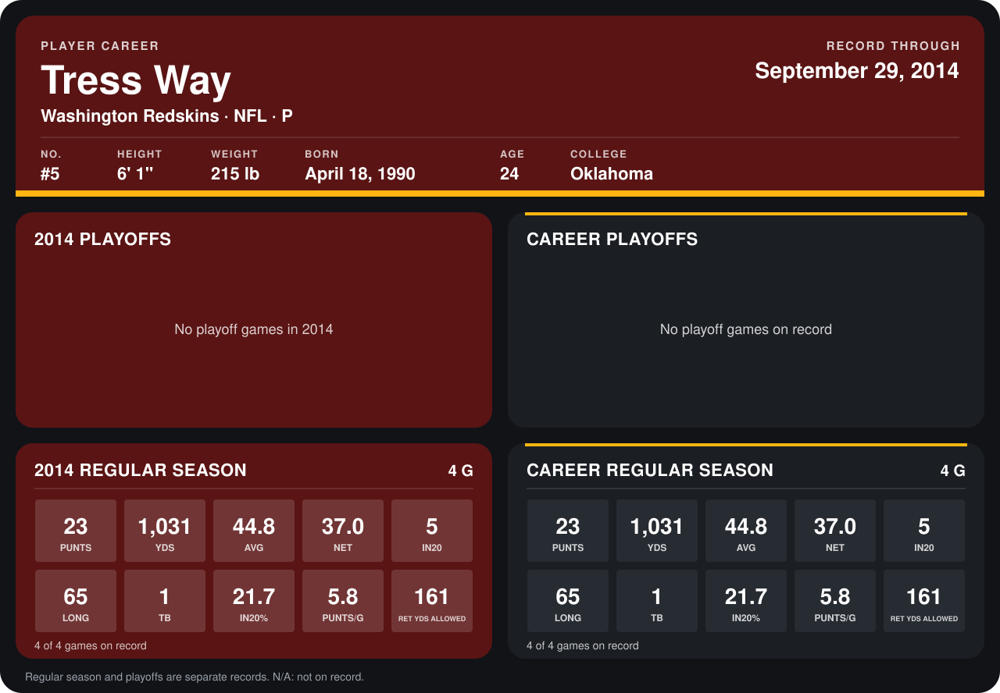

# Tress Way

## Career stats

### Regular season

| Season | Club | G | PUNTS | YDS | AVG | NET | IN20 | LONG | TB | IN20% | PUNTS/G | RET YDS ALLOWED |
|---|---|---:|---:|---:|---:|---:|---:|---:|---:|---:|---:|---:|
| 2014 | Washington Redskins | 5 | 27 | 1,200 | 44.4 | 36.7 | 5 | 65 | 2 | 18.5 | 5.4 | 170 |
| **Career** |  | 5 | 27 | 1,200 | 44.4 | 36.7 | 5 | 65 | 2 | 18.5 | 5.4 | 170 |

### Playoffs

No playoff games on record.

## Awards

None on record.

Records through October 6, 2014. Identity: listed 2014 roster data, Weeks 1-4; number: 2014 Week 1 roster. [All Washington Redskins players](README.md).
